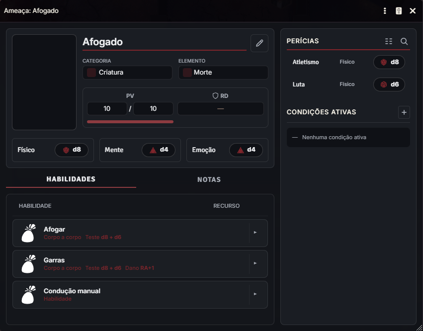
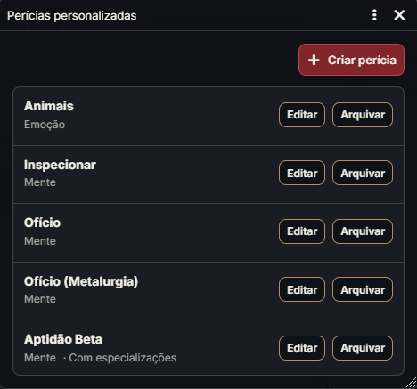
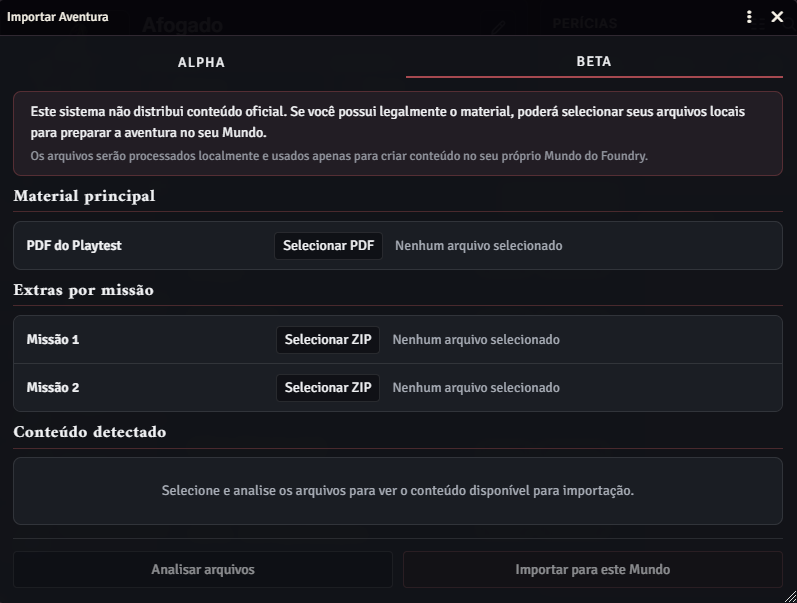

# Ordem Paranormal 2 — v0.7.0

Este é um conteúdo não oficial, publicado sob a Licença da Comunidade de Ordem Paranormal.

**Contém material gerado por inteligência artificial.**

## Destaques

- **Ficha de Ameaça:** organize PV, RD, atributos, perícias, condições e habilidades em uma ficha própria.
- **Habilidades reutilizáveis:** Agentes e Ameaças usam o mesmo tipo de item e compartilham o editor de habilidades.
- **Perícias personalizadas:** o Mestre pode criar perícias simples ou com especializações, com dados definidos por personagem.
- **Importador de Aventuras Beta:** importe a Missão 1, a Missão 2 ou ambas de Contos da Vigília a partir dos seus arquivos locais.

## Ficha de Ameaça

O Mestre pode cadastrar Ameaças com categoria, elementos, PV, RD, atributos, perícias e condições ativas. A ficha reúne as habilidades e notas da Ameaça, e a seção **Propriedades** dá acesso a vulnerabilidades, imunidades e Enigma de Medo.

Os tokens de Ameaça são desvinculados por padrão. Cada token mantém seus próprios PV e condições, e o chat identifica o token que usou a habilidade.

## Perícias personalizadas

Nas Ferramentas do Mestre, é possível criar, editar, arquivar e reativar perícias do mundo. Agentes e Ameaças recebem suas próprias perícias e dados. Em uma perícia especializada, cada especialização tem seu dado independente. O arquivamento preserva as referências existentes.

As perícias personalizadas podem ser usadas em testes pela ficha, solicitações de teste, testes opostos, usos de habilidades e abordagens de Pontos de Interesse.

## Importador de Aventuras Beta

Na aba **Beta**, o Mestre pode analisar o PDF do Playtest e importar **O Pântano dos Afogados** (Missão 1), **A Caverna de Cruachan** (Missão 2) ou ambas. O importador usa os extras ZIP das missões selecionadas para preparar Agentes, Ameaças, Pontos de Interesse, cenas, diários, handouts e músicas.

Os Agentes comuns ficam em uma pasta compartilhada. Ameaças, Agentes exclusivos e Pontos de Interesse ficam nas pastas de suas missões. A reimportação reconhece documentos já gerenciados, permite revisar conflitos de conteúdo e preserva movimentações manuais. A aba **Alpha** segue disponível para o material anterior.

O Mestre precisa fornecer o PDF e os ZIPs oficiais. Esses materiais são processados localmente e ficam fora do pacote do sistema.

## Habilidades compartilhadas

O Item `ability` pode ser reutilizado por Agentes e Ameaças. As formas de uso configuradas podem ser publicadas no chat ou iniciar um teste pelo fluxo normal de Check. As formas de combate podem incluir dano descritivo, imediato ou por rodada, conforme a configuração da habilidade.

## Compatibilidade e atualização

- Compatível com **Foundry VTT v14+**. A versão mínima e a versão verificada no manifesto são a **v14**.
- Antes de atualizar da **v0.6.0**, faça um backup dos seus mundos.

O projeto continua **source-available** sob a PolyForm Strict License 1.0.0. Releases públicas até v0.0.22 permanecem sob os termos MIT aplicáveis às cópias já distribuídas.

## Instalação

**Manifest estável** — [system.json](https://github.com/antoniohbmonteiro/ordemparanormal2/releases/latest/download/system.json)

**Pacote** — [ordemparanormal2-v0.7.0.zip](https://github.com/antoniohbmonteiro/ordemparanormal2/releases/download/v0.7.0/ordemparanormal2-v0.7.0.zip)

**Comparar alterações** — [v0.6.0...v0.7.0](https://github.com/antoniohbmonteiro/ordemparanormal2/compare/v0.6.0...v0.7.0)
