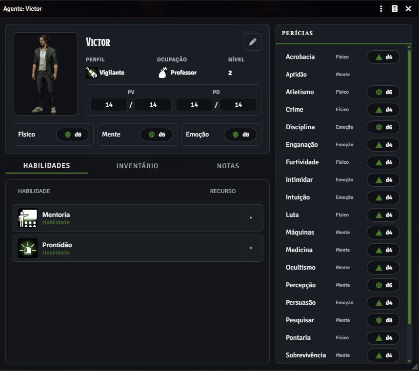
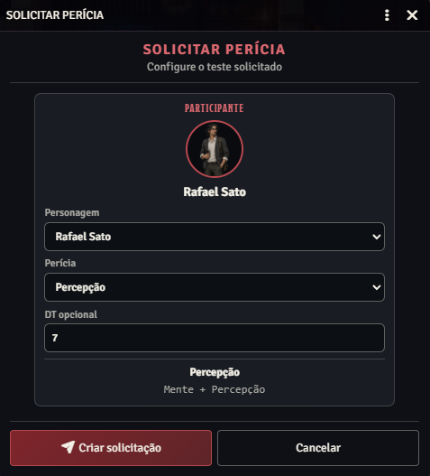
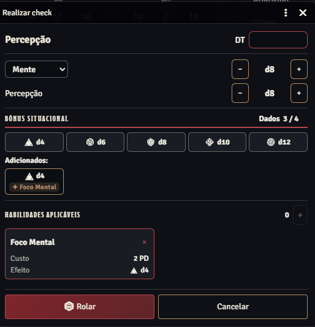
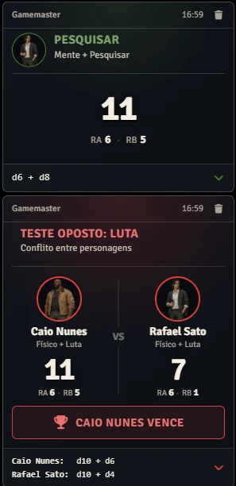
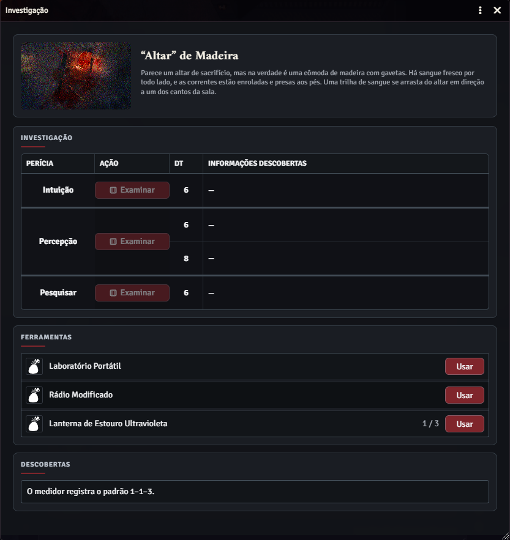
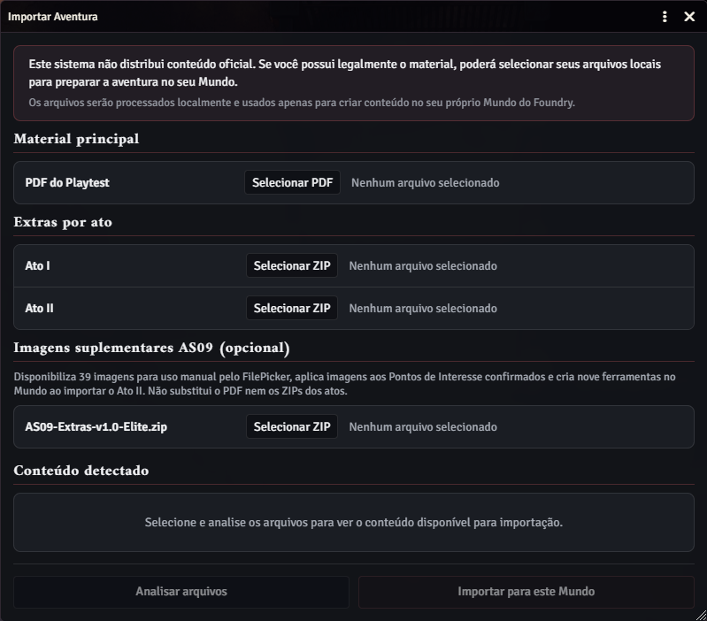
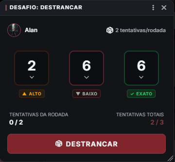
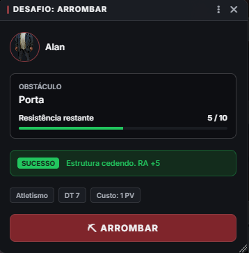

# Ordem Paranormal 2 para Foundry VTT — conheça o sistema

**Sistema comunitário não oficial para Foundry VTT v14**, baseado nas regras públicas de playtest de Ordem Paranormal RPG 2.

Fala, pessoal! Sou desenvolvedor e comecei este projeto para conseguir jogar o playtest de Ordem Paranormal 2 diretamente no Foundry VTT. A ideia é aproveitar os recursos da plataforma para facilitar a vida de quem joga e mestra, respeitando as regras confirmadas do playtest.

Esta apresentação reúne as principais funcionalidades disponíveis na **versão 0.6.0**, com capturas reais da interface.

## 🎭 Ficha de Agente

Perfil, Ocupação, atributos, Perícias, Aptidão, Habilidades, PV, PD, Inventário e Notas em uma ficha integrada.

  

## 🎲 Sistema de Testes

Checks com DT opcional, resultados críticos, RA/RB, dados situacionais, ajustes temporários dos dados e Habilidades aplicáveis antes da rolagem. Os ajustes não modificam permanentemente os valores da ficha.

O Mestre pode solicitar um teste de Perícia e o jogador autorizado resolve o pedido pelo diálogo normal de Check. Também há **Testes Opostos**, com os resultados reunidos em um card no chat.

### O Mestre solicita o teste

  

### O jogador prepara a rolagem

  

### O resultado aparece no chat

  

## 🔎 Investigação

Pontos de Interesse podem ser integrados às cenas e investigados por meio de Perícias, com informações reveladas aos personagens e compartilhamento de descobertas. O sistema também oferece ferramentas interativas de investigação, como **Laboratório Portátil** e **Rádio Modificado**.

  

## 📦 Importador de Aventura

O Importador de Aventura prepara os **Atos I e II do playtest** no Foundry VTT a partir dos arquivos fornecidos pelo próprio usuário. Ele pode criar Agentes, Handouts, Pontos de Interesse e cenas com mapas, paredes, portas e tokens, reduzindo o trabalho de preparação do Mestre.

O sistema **não distribui os materiais oficiais**: os arquivos precisam ser obtidos e fornecidos pelo próprio usuário.

  

## 🔐 Desafios de Acesso

A versão 0.6.0 introduziu dois desafios interativos, com interfaces próprias para Mestre e jogadores autorizados.

### Destrancar

O jogador tenta descobrir uma sequência secreta, recebendo feedback por posição. O desafio tem limites de tentativas e rodadas configurados pelas mecânicas aplicáveis.

  

### Arrombar

Utiliza Checks de Atletismo para reduzir a resistência do obstáculo. Cada tentativa confirmada consome PV, conforme a mecânica implementada.

  

## Quer testar?

- **[Instalar pelo diretório do Foundry VTT](https://foundryvtt.com/packages/ordemparanormal2)**
- **[Repositório e instruções de instalação](https://github.com/antoniohbmonteiro/ordemparanormal2)**
- **[Última versão](https://github.com/antoniohbmonteiro/ordemparanormal2/releases/latest)**
- **[Enviar bugs e sugestões](https://github.com/antoniohbmonteiro/ordemparanormal2/issues)**

O projeto está em desenvolvimento ativo. Feedback de quem joga ou mestra Ordem Paranormal 2 é muito bem-vindo!

---

**Aviso:** este é um projeto comunitário não oficial, publicado sob a Licença da Comunidade de Ordem Paranormal. Não é afiliado, patrocinado ou endossado pelos responsáveis pelo jogo. Consulte o [README do repositório](../README.md) para informações sobre licença, materiais de terceiros e uso de IA no projeto.
